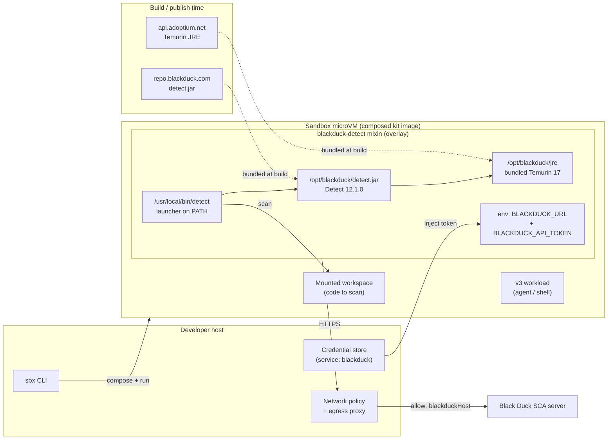

# Docker Sandbox Kits for Black Duck

[Black Duck](https://www.blackduck.com/) AppSec kits for
[Docker Sandboxes](https://docs.docker.com/ai/sandboxes/) - authored against the
v3 kit descriptor (`schemaVersion: "3"`).

These kits bring Black Duck's Application Security portfolio into sandboxed AI
coding agents: an agent running in an isolated microVM can scan the project it
is working on and surface open-source, license, and vulnerability risk without
leaving the sandbox.

## Architecture



At build time the kit bundles the Detect jar (`repo.blackduck.com`) and a
Temurin JRE (`api.adoptium.net`) into the overlay, so at runtime the sandbox is
self-contained and its only egress is the Black Duck server. The API token is
injected from the host credential store as `BLACKDUCK_API_TOKEN` and never
baked into the image.

## Kits

| Kit | Kind | What it adds |
|---|---|---|
| [`blackduck-detect`](./blackduck-detect) | mixin | Black Duck **Detect** SCA scanner (`detect` on PATH), with a bundled JRE and pinned jar |

## Why a mixin

A mixin overlays onto *any* agent workload - Claude Code, Codex, Copilot,
Gemini, or your own - so the same AppSec tooling drops into whatever agent the
team already runs. The `blackduck-detect` overlay is fully self-contained
(bundles its own Temurin JRE and the Detect jar), so it composes even onto a
base that ships no Java, and its only runtime network reach is your Black Duck
server.

## Quick start

A v3 mixin cannot run alone - the composed set needs one kit with
`kind: workload`, and the built-in `sbx` agents (`shell`, `claude`, …) are not
v3 kits. This repo ships a minimal [`test/shell-workload`](./test/shell-workload)
for exactly that. Compose the scanner onto it:

```sh
# 1. store your Black Duck API token under the service name `blackduck`
sbx secret set -g blackduck                       # paste the token when prompted

# 2. compose the scanner onto the workload (run interactively, NOT --detach, so
#    sbx prompts to bind the `blackduck` credential the first time)
sbx run ./test/shell-workload \
  --kit ./blackduck-detect \
  --kit-arg blackduck-detect.blackduckHost=bd.acme.com \
  --name bd-scan .

# 3. inside the sandbox
detect --detect.source.path=.
```

Step 1 keys the secret to `blackduck` because that is the credential service
the kit declares; it is injected into the sandbox as `BLACKDUCK_API_TOKEN`. A
secret under any other name will not be picked up.

See [`blackduck-detect/README.md`](./blackduck-detect/README.md) for full build,
run, and publish instructions.

## Testing

Smoke-test the published image with no Black Duck key - this proves the kit
composes and `detect` runs on its bundled JRE (the scan only fails to *connect*,
which is expected without a real server):

```sh
sbx run ./test/shell-workload \
  --kit docker.io/ajeetraina777/sbx-kits-blackduck:blackduck-detect \
  --detach --name bd-test .

sbx exec bd-test detect --help                    # Detect's option reference → wired up
sbx exec bd-test sh -c 'command -v detect; echo $BLACKDUCK_URL; echo $JAVA_HOME'
sbx rm bd-test -f                                 # clean up
```

With a real instance, add the token and point at your server. Detect's
connection test validates auth without running a full scan:

```sh
sbx secret set -g blackduck
sbx run ./test/shell-workload \
  --kit ./blackduck-detect \
  --kit-arg blackduck-detect.blackduckHost=bd.acme.com \
  --name bd-scan .
# inside the sandbox:
detect --detect.test.connection=true              # auth + connectivity check
detect --detect.source.path=.                     # full scan
```

## Published image

The kit is published to Docker Hub as a multi-platform (`linux/amd64`,
`linux/arm64`) OCI artifact:

```
docker.io/ajeetraina777/sbx-kits-blackduck:blackduck-detect
docker.io/ajeetraina777/sbx-kits-blackduck:blackduck-detect-12.1.0   # immutable
docker.io/ajeetraina777/sbx-kits-blackduck:latest
```

Consume it straight from the registry, no local build:

```sh
sbx run ./test/shell-workload \
  --kit docker.io/ajeetraina777/sbx-kits-blackduck:blackduck-detect \
  --name bd-scan .
```

The published image bakes the placeholder host, so to aim it at your instance
add `sbx policy allow network <host>` and pass `detect --blackduck.url=https://<host>`
at scan time. The `--kit-arg` host override only takes effect when building from
local source (`--kit ./blackduck-detect`), since a prebuilt image is already
baked.

Publishing is automated by [`.github/workflows/publish.yml`](./.github/workflows/publish.yml):
it gates on `kit-tck` conformance, then runs [`scripts/push-kit.sh`](./scripts/push-kit.sh)
to build and push both architectures in one invocation. It needs the
`DOCKERHUB_USER` and `DOCKERHUB_PAT` repository secrets.

> The published default bakes the placeholder `blackduck.example.com` host. For
> your instance, either run the workflow manually (set `blackduckHost`) or
> recompose locally with `--kit-arg blackduck-detect.blackduckHost=<your host>`.

## Requirements

- [`docker buildx`](https://docs.docker.com/engine/reference/commandline/buildx/) - builds the kit (BuildKit pulls the v3 frontend from the `# syntax=` line).
- [`sbx`](https://docs.docker.com/ai/sandboxes/install/) - runs and composes kits.
- [`kit-tck`](https://github.com/docker/sandbox-kit-spec) - conformance checking: `go install github.com/docker/sandbox-kit-spec/v3/cmd/kit-tck@latest`.
- A valid Black Duck SCA entitlement and server.

## License

The kit sources in this repository are Apache-2.0 licensed (see `LICENSE`).
Black Duck Detect itself is distributed under Black Duck's commercial EULA and
is not relicensed here.
